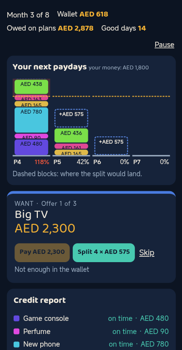
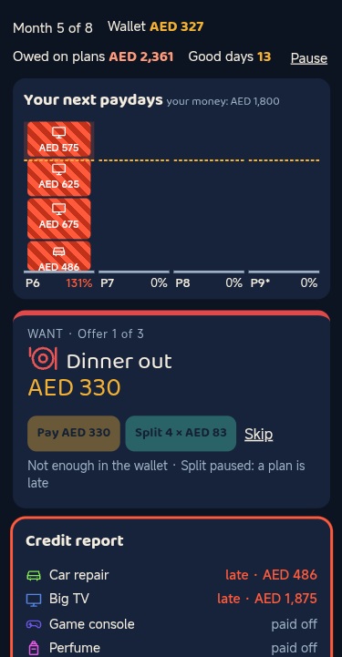
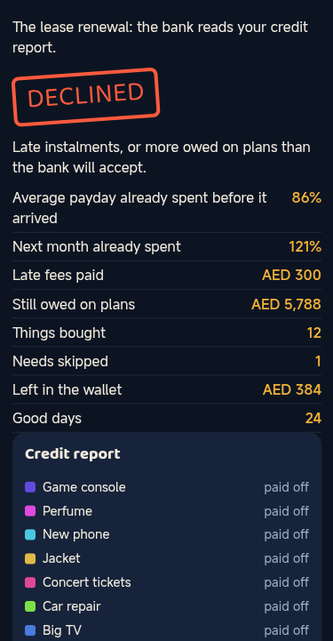
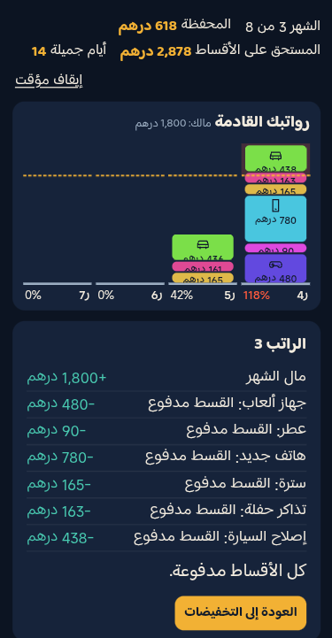
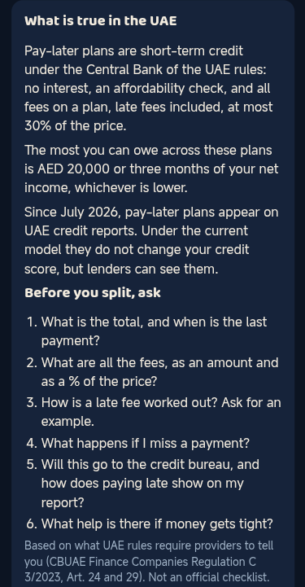

# Stacked

**Game Concept Document** for Zoud GameLab 2026, theme: Make FinLit Fun. Describes the build of 4 November 2026; it is updated with the build that is submitted.

[Play in the browser](https://designmaster-solutions.github.io/stacked-zoud/) · [Arabic edition](https://designmaster-solutions.github.io/stacked-zoud/?lang=ar) · [itch.io page](https://designmastersolutions.itch.io/stacked) · [Game budget (separate document)](https://designmaster-solutions.github.io/stacked-zoud/docs/BUDGET.pdf) · [Source code](https://github.com/DesignMaster-Solutions/stacked-zoud)

## 1. Game Overview

Stacked is a short one-thumb game about buy now, pay later. It is sale season in Dubai and offers keep arriving. Each one can be paid now, split in 4 or skipped. Splitting feels free, because only a quarter leaves today. The other three quarters drop as blocks onto your next three paydays, which stand on screen as columns. You watch the future fill up before you live it.

| | |
|-----------------|-----------------------------------------------------------------|
| **Title and genre** | Stacked (مُكدَّس). Light strategy with falling blocks, one sale season in eight paydays |
| **Platform** | Any browser today, by touch, mouse or keyboard, on a phone held upright or on a desktop. iOS and Android come with funding |
| **Audience** | Young adults and new workers in the UAE who shop on their phone, students who will soon, and the schools, universities and employers that run financial wellbeing sessions for them |
| **Length** | A season of eight paydays and 24 offers takes 6 to 8 minutes, so it fits a break, a commute or a class |
| **Editions** | English and Arabic (right to left), money in dirhams |

**Why this subject.** In the UAE, pay-later plans are credit. The Central Bank of the UAE brought them under its Finance Companies Regulation as short-term credit, and since July 2026 the Etihad Credit Bureau shows pay-later plans on UAE credit reports. A plan is small and interest-free, so it does not feel like borrowing. Its danger is the stack: four plans that each look easy can take most of a payday that has not arrived yet.

**What makes it different.** Of the 30 entries in this jam on 4 November 2026, the words "pay later" appear once each on the pages of four entries, all of them broad money-life games, and credit score shows up as one stat among many in a few others. None is built around instalments stacking on future income. In Stacked, the future paydays are the board.

## 2. Core Gameplay

**Objective.** Reach the end of the season with a clean credit report when the bank reads it for your car loan or your lease renewal, meet your needs, and have some good days on the way.

**Actions.** Three buttons on each offer: **Pay** the full price, **Split 4** (a quarter today), or **Skip**.

**The loop.** Each month has two short steps.

1. **The sales.** Three offers arrive one by one: sneakers, concert tickets, a new phone, a weekend trip, and once in a while a need: the car repair, the fridge that died, school fees. Before you choose, dashed blocks show where a split would land on your next three paydays, and each column shows what share of that month's money is already spent. An offer timer runs (off in Calm mode). Skipping a need is not free: it costs 40% of its price on the next payday and takes good days.
2. **Payday.** AED 1,800 arrives, what is left after rent, transport and what you send home. The column for this payday is paid line by line, oldest plan first, with a coin for each instalment. A column taller than your money misses an instalment: a late fee, a crash and a shake, the plan turns red on your credit report, and the missed part moves to the next payday. While a plan is late, the app pauses new splits, so the next surprise has nowhere to go.

| | | |
|-----------------------|-----------------------|-----------------------|
|  |  |  |
| The future, visible | A plan goes late | The bank decides |

**Decisions and progress.** Pay now and keep the future clear, or split and keep cash for the need that may come? Is this column still under the money line? Which plan do you let go red? The season builds: three needs land in fixed windows, the columns fill, and the last splits of the season are still owed when the bank reads the report. The bank gives one of three answers (approved, approved with conditions, declined) and the summary shows how much of each payday was already spent before it arrived, how much of next month is spent, the late fees, what is still owed, what you bought, the needs you skipped, what is left in the wallet and your good days.

**Why it is fun to repeat.** Blocks fall, columns grow, and a payday can be a clean sweep of coins or a crash. Every season deals different offers and puts the needs in different months, so the safe path moves. Good days give a reason to buy, and the bank gives a reason not to overdo it. A season is short, and "Play another season" is one tap away.

## 3. Financial Literacy Integration

There is no lesson screen. Four lines before the season starts, and after that every idea is a rule the player meets by playing.

| **Concept** | **The mechanic** | **What the player lives through** |
|---------------|-----------------------------|------------------------------------|
| Pay-later is credit | Every split becomes a plan on the credit report panel, on time, late or paid off | The bank at the end reads that report, not your intentions |
| Future income is not free money | Three quarters of each split land on the next three paydays, drawn as blocks in columns with a money line | "Average payday already spent before it arrived" on the summary |
| Each plan is small, the stack is not | Columns add up every plan due that month | Four easy splits can push a column over the line |
| Missed instalments cost money | A late fee per missed instalment, capped like the UAE rule at 30% of the price for all fees on one plan | Late fees, a red report and paused splits |
| Needs and wants share the same paydays | A need arrives when it arrives; skipping it costs more later | Splitting a need can be the smart move, if the future has room |
| Commitments outlive the purchase | Splits made in the last months are still owed when the bank looks | "Still owed on plans" and "Next month already spent" |

**The outcome rewards reading the future, not one pure rule.** Four ways to play, each played by a robot for 500 seeded seasons with the game's own money model (`table` in `econ.js`, build of 4 November 2026). Money in AED, averages per season.

| **Way of playing** | **Bank approves** | **Bank declines** | **Late fees** | **Good days** | **Left in the wallet** | **Needs skipped** | **Payday already spent** |
|-----------------------------|------:|------:|------:|------:|------:|------:|------:|
| Split whenever the app allows | 0% | 98% | 360 | 20 | 340 | 1.96 | 90% |
| Never split | 100% | 0% | 0 | 20 | 838 | 1.58 | 0% |
| Split only needs you cannot pay now | 100% | 0% | 0 | 23 | 1,350 | 0 | 9% |
| Read the columns: split only what fits under half the money line | 86% | 0% | 0 | 23 | 993 | 0.07 | 37% |

Splitting whenever the app allows spends 90% of each payday before it arrives and gets declined in 98% of seasons. Never splitting keeps the report clean but leaves about 1.6 needs a season unmet, and the good days fall with them. Using a split for a need that cannot wait, and only when the future columns have room, keeps the report clean, meets the needs and has the most good days.

### What we hope players understand after playing

1. A pay-later plan is credit, and it shows on your credit report in the UAE.
2. Before you split, look at the paydays it will land on, not at the quarter you pay today.
3. Many small plans add up to one big bill on the same payday.
4. A missed instalment costs fees and makes the next problem harder.
5. Keep splits for needs that cannot wait, and ask what a plan costs in total before you agree.

The game ends with six questions to ask before splitting, based on what UAE rules require providers to tell you (total and last payment date, all fees as an amount and a %, how a late fee is worked out, what happens on a missed payment, how it shows on your credit report, what help there is). They are a paraphrase of the regulation, not an official checklist, and the screen says so.

**Accuracy.** The real-world facts on screen are checked at the primary source and listed with links in the README: the Central Bank of the UAE Finance Companies Regulation C 3/2023 (short-term credit of 12 months or less with no interest, Art. 4; at most AED 20,000 or three months of verified net income, Art. 23.1; all fees including late fees at most 30% of the original credit, Art. 23.4), the CBUAE press release of 27 December 2023 that introduced the framework for "Buy-Now, Pay-Later", and the Etihad Credit Bureau press release of 27 July 2026 and its FAQ (pay-later plans on credit reports from July 2026, no effect on the credit score under the current model). The monthly money, prices, the AED 50 late fee, the in-game app limit, the cost of skipping a need and the bank's rule are game values and say so on screen. The shops, the app and the bank are fictional: no real company is named or rated in the game, and the game is not financial advice.

**UAE and Arabic edition, built during the jam.** The whole game runs in Arabic, right to left, and in English, with money in dirhams. Amounts use Latin digits in both languages, so the columns read the same in either.

## 4. Visual Style & Player Experience

| | |
|-----------------------|-----------------------|
|  |  |
| Payday in Arabic, right to left | The facts at the end |

**Art direction.** A night sale in deep blue with saffron for money and coral red for trouble. Every item has its own colour and its own pictogram, so a plan reads as the same block in every column and on the report. Blocks fall with weight, a missed instalment turns its block into red stripes and shakes the board. Everything is drawn in code, with no image files, so the game loads on a weak phone connection.

**Setting and tone.** Light and fair. The player has no name, gender or nationality. Buying things is not a sin in this game: good days count. The game only asks you to look at the paydays first.

**Sound.** Short synthesized sounds (WebAudio, no audio files): a drop when blocks fall, a coin for each instalment paid, a crash for a missed one, ticks in the last seconds of an offer. Every sound has a visual twin, so the game never depends on it.

**Interface.** One line at the top: month, wallet, owed on plans, good days and pause. The four paydays are always on screen, the offer card sits under them, and the credit report sits beside them on a desktop and under them on a phone. The three buttons stay on one line down to a 360 px phone.

**Accessibility, on the title card and saved on the device.** Large text, high contrast, Calm (no offer timer and no motion), plain words ("instalment" becomes "payment", "late fee" becomes "charge for paying late", "credit report" becomes "record banks read"; in Arabic too) and sound off. Pause from the top bar or with Esc. Keyboard, mouse and touch all play the whole game. A teacher or a trainer can share the settings by link (`?a11y=large,calm`).

## 5. Development & Future Plans

**In the prototype today.** A full season of eight paydays with 12 wants and 3 needs, pay now, split in 4 and skip, the future columns with the split preview, late fees with the UAE fee cap, paused splits, the credit report panel, the bank's three decisions and the summary with the UAE facts. English and Arabic, five accessibility settings and pause. An attract mode that plays a season by itself with a chosen strategy (`?autoplay=planner`). Automated tests for the money model and the balance table, the texts in both languages, the accessibility settings, the pictograms and the budget's arithmetic, and an end-to-end test that plays the published build on a real Android phone and checks that the phone and the model give the same season. The public commit history shows it growing during the jam.

**Not done yet.** Art and sound are prototype level. No real players have tested it yet, only an AI playtester. The Arabic was drafted with AI and checked in the game on a real device, but no native speaker has reviewed it. Only one sale season exists. It runs only in the browser.

### Priorities, in order

The plan is six months and 960 hours, and the budget shows what ships at each funding level.

1. Three rounds of playtests with young adults and new workers in the UAE, with before-and-after questions on the five lessons above.
2. Review of the Arabic by a native speaker, and the game in Hindi, Urdu and Filipino.
3. The UAE rules in one data file with source and date on screen, reviewed every quarter.
4. A session mode for schools, universities and employers' financial wellbeing programs: no personal data, a 10-minute session plan and a printable debrief.
5. iOS and Android release, tested on low-end phones and playable offline.
6. More seasons (Dubai Shopping Festival, back to school, Ramadan and Eid), original art and original music.

### Risks, and what we do about them

| **Risk** | **Our answer** |
|----------------------------------|---------------------------------------------------------------|
| Players enjoy it but do not learn | Before-and-after questions from the first playtest, a playtest report, and design changes if the answers do not move |
| The rules change | One data file with source and date on screen, reviewed every quarter; the game names the regulation it follows |
| The game reads as a rating of real providers | The shops, the app and the bank stay fictional and the lesson is a method (look at the paydays first), so it stays true whichever provider a player uses |
| It reads as "never use pay-later" | The balance table shows that splitting a need with room in the future is the best play; the game rewards good days |
| Our record is apps, not games | Art and sound go to specialists, and every stage is checked with players |

**Reaching players and paying for itself.** Players never pay: the web version stays free, with no ads and no data collected from them. Schools, universities, employers' financial wellbeing programs and public programs already pay for financial education, and they are who can sustain it, by licensing the session mode and seasonal editions. Banks and fintechs that want their customers to borrow well could sponsor a season, but we would not take money to put a real provider in the game, so the lesson stays neutral. We have no customers or partners yet. Our first step is a free pilot of the web build with one UAE school or program, using the before-and-after questions from the first playtest. Zoud, as the UAE's national financial wellbeing initiative, is the first place we would ask.

## 6. Your Team

**Alan De Bortolo (Brazil), Design Master Solutions LLC (Massachusetts, USA).** Solo entry; our other entries in this jam are [Snowball](https://designmastersolutions.itch.io/snowball) and Send Home. Stacked was built with an AI coding agent (Claude) under my direction: the code, the Arabic text, and drafts of the design and of this document, as disclosed in the submission. No image, music or voice generation models were used. The money model is checked by automated tests and the game is tested on real devices.

**Relevant experience.** The studio designs, codes, hosts and supports its own software products (Stone Project is live on iOS, Android, Mac, Windows and the web) and builds iOS and Android apps for clients, so store releases, support and localization are everyday work. Alan also builds LAPI, a personal and family finance app in Brazil (lapiapp.com), so how people really handle money is familiar ground.
